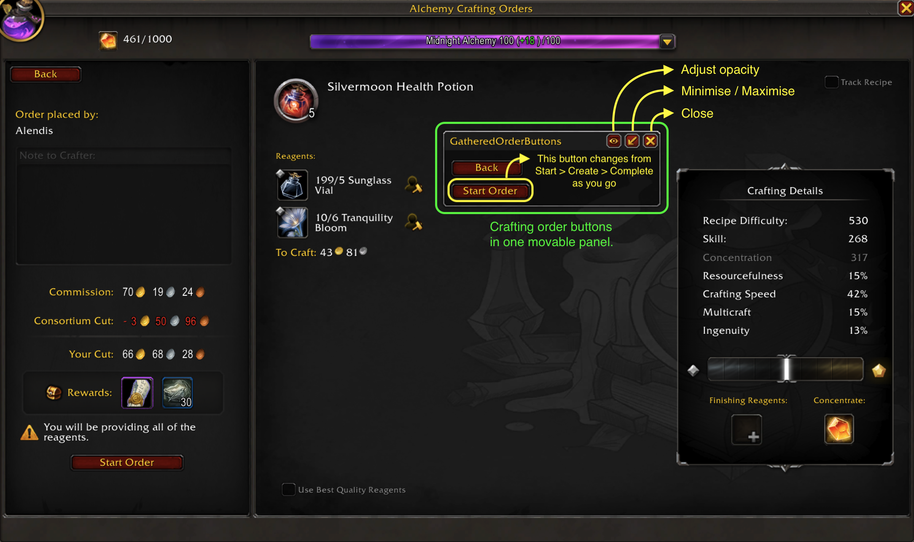
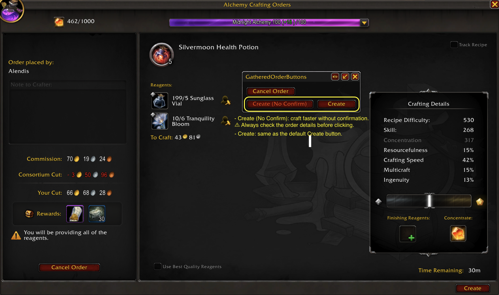
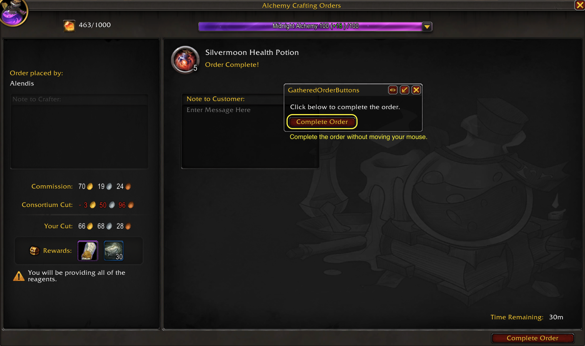

# GatheredOrderButtons

A World of Warcraft (Retail) addon that gathers all crafting order buttons into one movable panel, so you can start, craft and complete orders with barely any mouse movement.

I made this addon because moving my mouse back and forth between the Start Order, Create and Complete Order buttons while filling NPC patron orders got too tedious. Patron orders are the main focus, but it works the same for every other order type.







## Features

- **All order buttons in one movable panel.** Drag it anywhere; its position is saved.
- **Row 1:** Back, which becomes Release Order once the order is started.
- **Row 2:** changes from **Start Order → Create (No Confirm) | Create → Complete Order** as you go, so the next button is always under your mouse.
  - **Create:** same as the default Create button, confirmation popup included.
  - **Create (No Confirm):** for faster crafting. Crafts and automatically accepts the confirmation popup.
- **Title bar buttons:** opacity (10–100%), minimize and close. A closed panel reappears the next time you open an order.
- Tooltips from the original buttons (for example, why crafting is disabled) are shown on the panel buttons.
- The original Blizzard buttons stay where they are. This addon only adds shortcuts.
- Works with every order type: patron, personal, guild and public orders. Recraft orders are supported too.
- Localized in English and Korean.

## Slash commands

- `/gob reset` (or `/gatheredorderbuttons reset`): restore the default panel position, minimize state and opacity.

## ⚠ Use "Create (No Confirm)" with care

**Always check the order details (reagents, quality, commission) before clicking.** Once you click, the craft goes ahead without a second chance to cancel.

The button accepts **any** confirmation popup that appears as a result of that click, including warnings about soulbound or expensive reagents. If you want to review a warning, use the plain **Create** button instead.

The auto-accept only happens when you click the button yourself. The addon never crafts or accepts anything on its own.

## Installation

- **CurseForge app:** search for *GatheredOrderButtons*.
- **Manual:** download the release zip and extract it into `World of Warcraft/_retail_/Interface/AddOns/`, then restart the game.

## Packaging

Build the release zip from the parent directory, leaving out development files:

```bash
zip -r -X GatheredOrderButtons-<version>.zip GatheredOrderButtons \
  -x "*.DS_Store" -x "__MACOSX*" -x "*/.git/*" -x "*/.gitignore" \
  -x "*/luac.out" -x "*/curseforge/*" -x "*/README.md"
```

## License

[MIT](LICENSE) © SatkatKim

---

## 한국어

NPC 손님 의뢰를 처리하면서 주문 시작, 제작, 주문 완료 버튼 사이를 오가는 게 너무 귀찮아서 만든 애드온입니다. 주문 버튼을 모두 하나의 이동 가능한 패널에 모아, 마우스를 거의 움직이지 않고 주문을 끝낼 수 있게 해 줍니다.

- 패널은 드래그로 옮길 수 있고, 위치는 저장됩니다.
- 1줄: **뒤로** → 주문 시작 후 **주문 취소**
- 2줄: **주문 시작** → **제작 (확인 생략) | 제작** → **주문 완료** 순서로 같은 자리에서 바뀝니다.
- 제목 줄의 버튼으로 투명도(10–100%) 조절, 최소화, 닫기를 할 수 있습니다.
- `/gob reset`(또는 `/gatheredorderbuttons reset`)으로 패널 위치, 최소화 상태, 투명도를 초기화합니다.
- 재제작 주문에서는 버튼 이름이 **재제작**, **재제작 (확인 생략)**으로 바뀝니다.

**'제작 (확인 생략)'은 그 클릭으로 뜬 확인 팝업을 종류와 상관없이 모두 수락합니다. 누르기 전에 주문 내용(재료, 품질, 수수료)을 꼭 확인하세요.**
