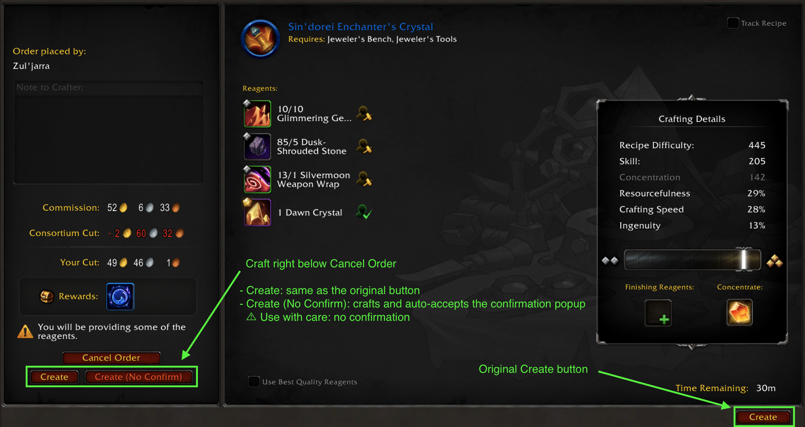
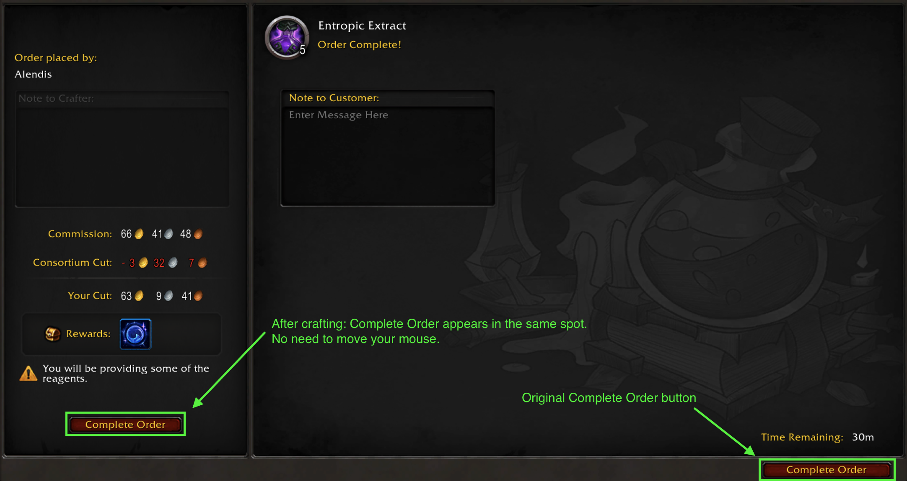

# GatheredOrderButtons

A World of Warcraft (Retail) addon that gathers the crafting order buttons in one spot, so you can start, craft and complete orders with barely any mouse movement.

I made this addon because moving my mouse back and forth between the Start Order and Create buttons while filling NPC patron orders got too tedious. Patron orders are the main focus, but it works the same for every other order type.





## Features

- **Two craft buttons right below the Release Order button:**
  - **Create**: works exactly like the default Create button, confirmation popup included.
  - **Create (No Confirm)**: crafts and automatically accepts the confirmation popup.
- **After crafting, Complete Order appears in the same spot.** Click again without moving your mouse.
- The original Blizzard buttons stay where they are. This addon only adds shortcuts.
- Works with every order type: patron, personal, guild and public orders. Recraft orders are supported too.
- No settings and no saved data.
- Localized in English and Korean.

## ⚠ Use "Create (No Confirm)" with care

**Always check the order details (reagents, quality, commission) before clicking.** Once you click, the craft goes ahead without a second chance to cancel.

The button accepts **any** confirmation popup that appears as a result of that click, including warnings about soulbound or expensive reagents. If you want to review a warning, use the plain **Create** button instead.

The auto-accept only happens when you click the button yourself. The addon never crafts or accepts anything on its own.

## Installation

- **CurseForge app:** search for *GatheredOrderButtons*.
- **Manual:** download the release zip and extract it into `World of Warcraft/_retail_/Interface/AddOns/`, then restart the game.

## Packaging

Build the release zip from the parent directory, leaving out development files:

```bash
zip -r -X GatheredOrderButtons-<version>.zip GatheredOrderButtons \
  -x "*.DS_Store" -x "__MACOSX*" -x "*/.git/*" -x "*/.gitignore" \
  -x "*/luac.out" -x "*/curseforge/*" -x "*/README.md"
```

## License

[MIT](LICENSE) © SatkatKim

---

## 한국어

NPC 손님 의뢰를 처리하면서 주문 시작 버튼과 제작 버튼 사이를 오가는 게 너무 귀찮아서 만든 애드온입니다. 필요한 버튼을 주문 화면 왼쪽 아래 한곳에 모아, 마우스를 거의 움직이지 않고 주문을 끝낼 수 있게 해 줍니다.

- '주문 취소' 버튼 바로 아래에 **제작**과 **제작 (확인 생략)** 버튼을 추가합니다.
- 제작이 끝나면 같은 자리에 **주문 완료** 버튼이 나타납니다.
- 재제작 주문에서는 버튼 이름이 **재제작**, **재제작 (확인 생략)**으로 바뀝니다.

**'제작 (확인 생략)'은 그 클릭으로 뜬 확인 팝업을 종류와 상관없이 모두 수락합니다. 누르기 전에 주문 내용(재료, 품질, 수수료)을 꼭 확인하세요.**
